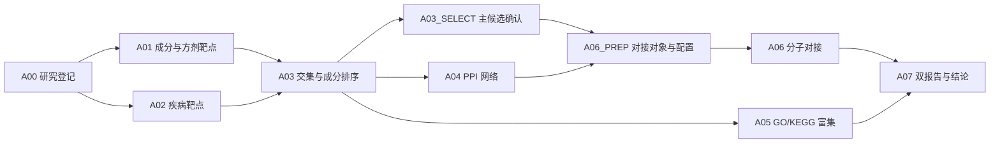
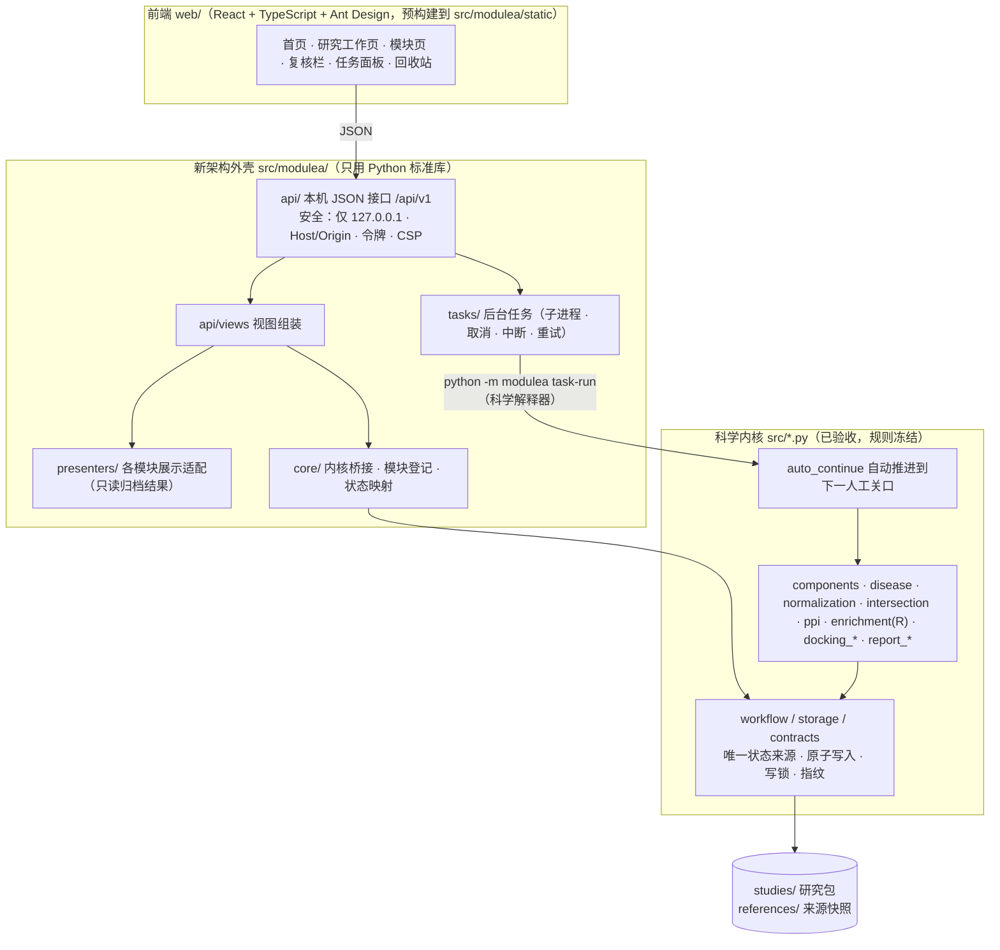

# Module A 独立代码仓库（moduleA-）

本仓库只保存正式代码、前端构建产物、测试、项目文档、大纲、模板和配置样例。实际研究资料、来源数据库、环境工具和运行日志独立留在本地；空代码仓库不能据此视为已具备真实研究全流程环境。

- **来源基线**：`Morishima33/moduleA`，分支 `docs/architecture-redesign-v1`，提交 `d2c1ee68483142b8e69a11c63ade1228ed4b5609`。本仓库建立独立历史，没有上传旧仓库的研究历史。
- **当前完成**：独立代码基线、模块完成后 GitHub 自动上传、外壳基础修复，以及三库 A01 生产契约、分库上传与整理、A02 分库补充、来源名称与 A03 前十排名显示；开发分支为 `development`，不自动合并 `main`。
- **2026-10-10 用户确认**：A00—A03 已确认。A04 PPI 四个核心文件与原项目当前版本原字节一致，先复用代码、等待修改要求，暂不计算；[A04 文件用途与来源索引](src/science_modules/a04/README.md)。当前 A03 用户网页通过记录保留，不自动接续计算。
- **尚未完成**：A00—A03 新页面全部操作接入（新研究、自动采集编排、范围及身份处理、候选选择）及完整科研流程验收。A01支持按模板包装当前处方三库官方资料并独立整理；自动联网采集不在本轮范围，三库完整且共同HGNC依据齐备方可处理。双报告模板和科学内核继续保留原有内容，科研运行环境位置保持原状。
- **基础问题已处理**：已验证 Git 归档字节保护；修复启动失败滞留、连接未关闭、doctor 检错解释器、非法整数参数返回 500，并修复 Windows 进程检测误终止与网页失败提示。已经发生换行转换的旧检出需要按 Git 原始字节重新取得独立副本；原下载基线保留。详见 [基础修复核查与大纲待确认项](docs/基础问题修复核查_v1_20261009.md)。

[三库代码与最新结果接入](docs/A01三库代码与结果接入_v1_20261009.md) · [GitHub 自动上传说明](docs/GitHub自动上传说明_v1.0.md) · [本轮技术核查](docs/GitHub上传配置技术核查_v1_20261009.md) · [项目工作约定](AGENTS.md) · [上传工具](tools/README.md)

目录仍按重构基线职责组织：`src/modulea/` 是接口/展示/任务外壳，`src/*.py` 与 R 文件为科学内核，`web/` 为前端，`tests/` 为测试，`docs/` 为项目文档，`templates/` 为模板规格，`config/` 只提交样例，`tools/` 为本仓库上传工具。以后按模块迁入时补充代码索引。

实际运行需指定独立数据根目录；不要为了启动复制原项目个人配置或默认读写原项目研究。以下保留源分支的使用和架构说明，其中研究状态、历史路径及未提供的 `studies/`、`references/`、`governance/` 内容属于来源背景，并非本仓库随附资料。

---

# Module A：网络药理学与分子对接通用初筛工作台

一次输入**一个方剂 + 一个已选定疾病**，半自动完成成分与靶点整理、疾病靶点汇集、交集、PPI 网络、GO/KEGG 富集、有限数量的分子对接，最后输出专业详细版和临床简略版两份 Word 报告。每个模块都在本机网页中由专业人员复核，所有结果可追溯到具体资料、参数和版本。

> 开发前必读：[AGENTS.md](AGENTS.md)（项目约束）→ 本文 → 要改动部分的 `AGENTS.md`。
> 用 Codex 开发：见 [docs/Codex使用说明.md](docs/Codex使用说明.md)。本次重构做了什么、后续怎么做：见 [docs/架构重构交接说明_v1_20261009.md](docs/架构重构交接说明_v1_20261009.md)。
> 已批准大纲：[docs/ModuleA首版项目指导大纲_v1.0.docx](docs/ModuleA首版项目指导大纲_v1.0.docx)。

---

## 数据库名称与前十排名

成分与方剂靶点三库：**TCMSP、HERB、BATMAN-TCM**。当前疾病靶点五库：**GeneCards、OMIM、TTD、PharmGKB、Open Targets Platform（OTP）**；历史研究中的DisGeNET等按绑定方案保留。库数表示来源方案，查询零命中、获取失败、未提供资料分别显示。

A03展示按不同交集靶点数排列的前十个成分，保留截断并列和完整排名查询。前十仅用于核查，不自动入选对接。详情见[本轮说明与大纲核对项](docs/来源说明与分库上传及前十排名_v1_20261009.md)。

## 1 快速开始

| 方式 | 命令 | 说明 |
|---|---|---|
| 新版工作台（Windows） | 双击 `start_v2.cmd` | 新界面 + JSON 接口，默认 http://127.0.0.1:8780 |
| 新版工作台（macOS/Linux） | 双击 `start_v2.command` | 同上；需要 Python ≥ 3.11 |
| 原工作台（Windows） | 双击 `start.cmd` | 原网页，http://127.0.0.1:8765；模块操作（运行、上传、范围决定、候选选择、对接方案、通路审核）目前仍从这里进入 |
| 环境检查 | `PYTHONPATH=src python3 -m modulea doctor` | 检查数据目录、归档核验、科学依赖 |

新版工作台本身只需要 Python 标准库，任何电脑都能打开、查看和复核。后台科学计算（自动接续、对接等）需要科学依赖：在 `config/local.toml` 中用 `science_python` 指定已安装依赖的解释器（样例见 `config/local.example.toml`）。

两个工作台读写同一套研究数据和同一个写锁，可以并存使用。

---

## 2 研究流程



| 模块 | 做什么 | 关键规则（详见 AGENTS.md 第 4 节） |
|---|---|---|
| A00 | 登记方剂、药味、疾病；MeSH 向 NLM 官方核对 | 首版只纳入本病 |
| A01 | TCMSP 快照整理成分、药味归属、成分—靶点 | OB≥30%、DL≥0.18；HGNC 统一身份 |
| A02 | 五个来源汇集疾病基因、范围复核 | 失败不是 0 条；不新增评分阈值 |
| A03 | 交集 I = T ∩ D；成分双排序 | 交集是 PPI 与富集的共同输入 |
| A03_SELECT | 确认进入对接的成分 | 默认最多 5 个；并列和药味代表须人工确认 |
| A04 | STRING PPI，三指标两轮 | 9606、score≥0.9、全部有边分量 |
| A05 | GO 三类与 KEGG 过度代表分析 | BH p.adjust < 0.05 |
| A06_PREP | 受体结构、搜索盒、参考配体重对接质控 | RMSD ≤ 2 Å；失败不自动调参 |
| A06 | Vina 对接矩阵与热图 | 固定 Top-1；NA 不补 0 |
| A07 | 两份 Word 报告与共同结论 | 结论必须人工复核 |

**人工关口**：每个模块都要人工复核（通过 / 退回 / 暂存）。“保存并继续”只会自动生成下一批结果，停在下一个人工关口，程序从不代签。上游产生新版本时，依赖它的下游自动失效；没有依赖关系的分支不受影响。

---

## 3 架构

### 3.1 两层结构



**为什么这样分**：科学内核里装着几十条已经由用户逐条确认的规则，已批准结果也由它产生，重写的风险大、收益小，所以保留并冻结。网页、编排、展示这层问题最多（单线程卡顿、字符串拼接页面、到处判断模块编号），所以重做。

### 3.2 关键设计

| 设计点 | 做法 |
|---|---|
| 状态只算一次 | 全部状态由 `Workflow.view()` 计算；`core/status.py` 只把内核状态翻译为前端状态码，前端不推算 |
| 不阻塞网页 | 接口服务多线程；长计算在后台子进程运行，网页立即返回，任务面板显示进度、日志、取消、重试 |
| 依赖轻 | 接口进程只用标准库，任何电脑可查看与复核；科学依赖只在后台任务进程中加载 |
| 展示与计算分离 | `presenters/` 只读已归档的 `result.json` 生成关键数字、数量变化链、重点核对项和专属图数据；不计算、不联网 |
| 不可覆盖 | 运行、复核、报告只追加；`manifest.json` 是唯一当前指针；写入在跨进程写锁内原子完成 |
| 可追溯 | 每个运行固定上游版本、输入与配置指纹、代码与环境版本；文件下载只允许归档索引中、指纹核验通过的文件 |
| 历史可复算 | 重构前完整代码在 git 标签 `legacy-v1-20261008`；规则版本只增不改 |
| 路径不写死 | 本机路径只在 `config/local.toml`；数据目录可通过 `--data-root` 或 `MODULEA_DATA_ROOT` 指定 |

### 3.3 状态模型

| 状态码 | 中文 | 含义 |
|---|---|---|
| idle | 未开始 | 上游尚未全部通过 |
| ready | 可以开始 | 上游已通过，本模块尚无运行 |
| running / incomplete | 运行中 / 未完整提交 | 有后台任务在跑 / 没有任务但结果未提交（可能已中断） |
| failed | 执行失败 | 计算失败，不等于 0 条 |
| waiting | 等待资料 | 有资料、范围或身份问题未处理，暂不能通过 |
| empty | 有效空结果 | 计算完整但没有结果，可以复核 |
| review / hold / returned | 待复核 / 暂存 / 已退回 | 人工复核状态 |
| approved / published | 已通过 / 已发布 | 可交下游使用；A07 通过即两份报告发布 |
| stale | 已失效 | 上游已变化，旧文件保留但不能交下游 |
| unavailable | 归档未就绪 | 归档文件指纹核验失败（例如 LFS 文件未下载完） |

### 3.4 本机接口一览

完整契约见 [src/modulea/api/AGENTS.md](src/modulea/api/AGENTS.md)。

| 端点 | 用途 |
|---|---|
| `GET /api/v1/session` | 令牌与能力开关 |
| `GET /api/v1/studies`、`/trash`、`/inbox` | 研究卡片、回收站、跨研究待办 |
| `GET /api/v1/studies/{sid}` | 研究页：导航、下一步、用途横幅 |
| `GET /api/v1/studies/{sid}/modules/{mid}` | 模块页：重点核对项、关键数字、数量变化链、专属图数据、参数、追溯、复核栏、下游影响 |
| `GET .../tables/{name}`、`GET .../files/{key}` | 完整明细分页、归档文件下载 |
| `POST .../reviews`、`POST /studies/{sid}/reviews:batch` | 复核（含“保存并继续”）、A01+A02 一次提交 |
| `POST /studies/{sid}:continue`、`:trash`、`:restore` | 推进到下一关口、回收站 |
| `GET/POST /api/v1/tasks...` | 后台任务查询、日志、取消、重试 |

---

## 4 目录

| 目录 | 职责 |
|---|---|
| `src/modulea/` | 新架构外壳（接口、展示、任务、配置）；`static/` 为前端构建产物 |
| `src/*.py`、`src/enrichment.R` | 科学内核与原网页（规则冻结，见 [src/AGENTS.md](src/AGENTS.md)） |
| `web/` | 前端源码（React + TypeScript + Ant Design），见 `web/README.md` |
| `tests/` | `tests/modulea/` 外壳测试；`tests/test_*.py` 科学内核测试 |
| `docs/` | 已批准大纲、技术流程图、使用说明、数据字典、方法学汇报资料、Codex 使用说明、架构重构交接说明 |
| `config/` | `local.example.toml`（本机配置样例）；`local.toml` 不提交 |
| `environments/` | 依赖与工具安装记录、固定的对接工具包 |
| `references/` | 共享来源快照（TCMSP、HGNC、富集注释包等，内容寻址） |
| `studies/` | 每项研究的独立结果包，不覆盖、不迁移 |
| `governance/` | 已关闭的施工与决策档案（只读），含冻结基线、授权记录、旧版 AGENTS/README 全文 |
| `templates/` | 报告模板规格 |

研究包结构：

```text
studies/<study_id>/
  manifest.json                 唯一当前指针
  intake/<run_id>.json          每版登记原文
  raw/                          原始资料（共享快照按内容指纹命名）
  normalized/                   规范化资料
  runs/<模块>/<run_id>/          run.json、result.json、明细 CSV、异常、执行记录、图
  reviews/                      复核记录（只追加）与回收站管理记录
  reports/<报告修订>/            两份 Word 与图
  task_packages/<编号>/          PyMOL 出图任务包
```

---

## 5 开发

```bash
# 外壳测试（任何平台）
PYTHONPATH=src python3 -m unittest discover -s tests/modulea -v

# 生成演示数据（只读源研究，复制其当前结果到新的演示目录）
PYTHONPATH=src python3 -m modulea.devtools.demo_data /tmp/moduleA-demo --source . --study <研究编号>

# 用演示数据启动接口，允许前端开发服务器跨源访问
PYTHONPATH=src python3 -m modulea --data-root /tmp/moduleA-demo serve --port 8799 --no-browser --allow-origin http://localhost:5173

# 前端开发与构建（见 web/README.md）
cd web && npm install && npm run dev      # 开发
cd web && npm run build                   # 构建到 src/modulea/static
```

**下一步路线**（每项单独 PR，细节见 [src/AGENTS.md](src/AGENTS.md) 第 3 节；给 Codex 下任务的模板和推荐顺序见 [docs/Codex使用说明.md](docs/Codex使用说明.md)）：

1. 模块操作接入新接口（运行、上传、范围批量决定、候选选择、对接方案确认、通路审核），之后新版工作台可完全替代原网页。
2. 历史授权从代码移到研究包内的决定文件；修复 `ppi_flow` 默认授权回退缺陷；统一 A07 校验。
3. 复算护栏工具：已批准运行的归档指纹核验 + 冻结实现从归档输入复算比对。
4. 合并重复实现（报告生成器、热图、任务包、重对接入口）；对接复用键改为算法版本号。
5. 依赖锁定（pyproject、renv）与工具清单；平台路径全部配置化。

---

## 6 当前状态

见 [AGENTS.md 第 5 节](AGENTS.md#5-当前状态2026-10-08)。2026-10-08 之前的完整进度日志见 [governance/README_历史全文_至20261008.md](governance/README_历史全文_至20261008.md)。

## A04双分支代码与演示范图

已实现Degree与BC/CC独立两轮，第二轮前十／前十五及并列、网页表格和专业报告第15版适配。真实研究未计算，正式图方案待用户核查范图；后续对接来源另行确认。[规则、文件索引与大纲核对项](docs/A04双分支筛选与报告说明_v1_20261010.md)。

## 2026-10-10 第一轮Degree图表确认及A04计算授权

用户已认可过敏性鼻炎历史数据的第一轮网络及前十版式，并要求固定代码、图表和开始当前页面计算。现行A04.dual.2：两分支两轮阈值保持；Degree图及五列表格改取第一轮前十（含边界并列），BC/CC表仍取第二轮前十五。此条覆盖此前“Degree表取第二轮前十”要求。第一轮全部节点保留，前十及并列标红并用真实基因符号标注，其他蓝色；图→图注→五列表格，列为基因、HGNC、Degree、Betweenness、Closeness，无名次。

实际计算只使用重构独立快照的当前已批准A03，不复用旧A04数值，不自动批准结果或启动A05/A06；对接来源另行确认。新增后台a04_ppi及网页计算按钮；专业报告适配第16版保留第15版。完成后停在A04核查，图表及大纲条目按结果汇报。详见docs/A04第一轮图表与计算说明_v2_20261010.md。

## 2026-10-10 第二轮圆形图确认（现行）

用户要求Degree图改用第二轮，随后明确认可圆形分散布局并要求写入代码继续。新增A04.dual.3：筛选阈值、完整网络原指标、四轮名单和既有表格口径不变；网络展示第二轮全部候选及真实诱导边，仅第二轮前十和边界并列标红标注，其余蓝色，节点避免重叠。圆形位置仅用于展示。Degree表仍保留dual.2已确认的第一轮前十、五列表格，BC/CC仍为第二轮前十五；图→图注→第一轮Degree前十表→第二轮BC/CC表，各自轮次明确标注。专业报告新增第17版，旧版可复核，历史归档不回写。

本次仅用同研究、同一已批准A03的归档STRING来源生成A04图件修订，不再次查询STRING；不代签A04、不启动A05/A06。15项STRING身份仍待核验，不能以图件认可视为身份例外授权或研究验收。大纲变更说明见docs/A04第二轮圆形图与表格说明_v3_20261010.md；正式Word大纲不自动改写。

## 2026-10-10 Degree展示顺序修订（用户确认）

用户明确要求先显示Degree第一轮前十表，再显示第二轮圆形网络图。现行顺序为：第一轮Degree五列表及简短说明→第二轮圆形图及图注→第二轮BC/CC前十五表。网页与专业报告第17版同步；只调整排版，不改变筛选规则、数值、候选名单、图件、审批或上游版本，不重算研究。该条替代上一条图在表前的顺序。

## 2026-10-10 核验事项优先展示

用户要求待核验事项突出显示，不再隐藏在结果末尾。模块页先显示标题，再显示必须处理事项；A04身份清单默认展开，输入基因、HGNC编号、STRING返回及本项证据均为中文入口，当前与历史版本分别绑定原运行。整体复核与身份核验明确区分，状态、科学结果、授权范围及通过门控不变；本轮不重算、不代签。


## A04身份核验操作（2026-10-10）

身份清单上方提供“确认补查方案并应用”，单项证据窗口提供相应入口；实际核验人、说明与明确确认必填。后台按已确认科学规则补查，新版另行复核；失败原因及原文留存，历史和原项目不覆盖。[操作步骤与大纲待确认项](docs/A04身份方案确认与应用_v1_20261010.md)。

## 2026-10-11 A04固定与A05微调准备

A04用户已确认完毕，当前研究页面通过记录已核对。现行规则、图表顺序和身份方案固定，见[A04确认基线](src/science_modules/a04/确认基线_20261011.json)。

A05旧版当前四个核心文件已在仓库，与原项目逐字节一致；[A05模块文件用途及微调位置](src/science_modules/a05/README.md)。本轮只完成代码准备，不启动真实富集。旧A05保留为失效历史，不能与当前A03混用；R脚本路径适配及来源准备在后续明确调用时处理。

## 2026-10-11 A05完整运行链自测

[A05运行适配](src/science_modules/a05/flow.py)已解决独立代码／数据根的R脚本路径和首次来源目录。真实R、HTTP→后台子进程→归档与网页链路以及GO/KEGG首次来源获取已自测通过；[检查与边界说明](docs/A05运行自测与路径适配_v1_20261011.md)。原四个科学文件、统计口径和当前研究保留；当前A05仍待用户微调后运行。

## 2026-10-11 A05图表与确认

本轮新增科研配色、中英文GO/KEGG图表及置顶确认区，提供跨页全选、取消、证据、范围和版式确认。真实预览待用户核查；专业报告第18版仅调整A05段落，完整A07尚未生成。见[使用说明、文件索引及已确认大纲增补](docs/A05富集图表与人工确认_v2_20261011.md)。

用户已于2026-10-11确认本轮A05大纲增补。清单、版式和研究结果仍通过页面独立复核；本次大纲确认不代签研究结果。

## 2026-10-11 A05紧凑核查与分列表格（现行）

[第三版说明与代码索引](docs/A05紧凑核查与中英文分列_v3_20261011.md)：疾病名称清单25条分页、简短提示，GO三列表、KEGG四列表，英文中文分列，GO编号小字号及图尺寸保持，KEGG单蓝渐变。专业报告第19版同步；仅新增同源展示，统计及旧结果保留，清单、版式与结果复核仍独立。

## 2026-10-11 KEGG展示保护

[排除应用后展示说明](docs/A05排除应用后展示说明_v1_20261011.md)：先确认清单并等待应用，再显示KEGG图及两张表；修改勾选或应用未完成时隐藏旧结果。只重筛选和绘图，不重算原富集统计。

## 2026-10-11 A05确认区折叠（用户要求）

A05确认区默认收起核查清单与操作表单，顶部持续显示展示范围、版式状态及整体复核入口；“展开核查与确认”可重新操作，折叠不重置填写、勾选或触发提交。未保存修改和提交错误仍在收起时提示。科研图表、排除范围和审批规则保持既定要求。

## 2026-10-11 A06代码复用与两梯队准备
新增A/B候选和A04末尾交集表；读取已批准第二轮归档，不重算PPI或富集。24个既有科学文件保留原位置，建立模块索引。真实对接、结构方案与配体选择等待后续微调。[规则及大纲条目](docs/A06两梯队候选与代码复用_v1_20261011.md)；[模块代码索引](src/science_modules/a06/README.md)。

## A06代码修改阶段（2026-10-11）
两梯队已接入方案字段校验、版本留存和同源结果标签；冻结的科学计算键与参数保持。全部执行阶段关闭，本轮只用隔离资料测试，当前研究保持不变。[修改说明](docs/A06代码复用与两梯队衔接_v2_20261011.md)。

用户已于2026-10-11确认本轮[A06大纲增补](docs/A06代码复用与两梯队衔接_v2_20261011.md)。两梯队与版本绑定、候选级别和结构质控分列、方案留存与结果批准分离按已确认条目执行；真实计算仍待明确指示。

## A06两遍核查（2026-10-11）
当前成分选择→独立复核→受体两遍方案核查→保存方案已接入网页；支持来源SDF版本归档、跨页全选及缺资料阻断。保存不计算、不批准科学结果。严格及AlphaFold探索阈值、模块文件位置和操作说明见[A06两遍核查说明](docs/A06两遍核查与方案确认_v3_20261011.md)。


用户已确认[A06两遍核查大纲增补](docs/A06两遍核查与方案确认_v3_20261011.md)。成分、结构方案、口袋证据与研究结果仍分别核查；真实计算继续等待明确指示。


## A06十五成分核查与同批矩阵（2026-10-11）
置顶显示本轮名单、身份及三维缺口，旧失效结果默认折叠；支持可确认项全选、明确保存与独立复核。研究级配置绑定当前来源，8×8热图与15×15表裁切同一完整15×17批次，无评分显示待计算。真实执行继续关闭。[操作、模块位置与大纲增补](docs/A06十五成分核查与同批矩阵_v4_20261011.md)。


## 2026-10-11 A06受体资料核查（用户继续授权）
当前成分分支已确认后按两遍核查顺序推进；来源冲突不纳入。新增版本绑定的官方身份/实验结构摘要核查包与折叠证据，明确目标链、片段长度、覆盖率、突变、共晶组分及历史失败；摘要或历史通过不能代替本次质控。待核查候选只载入输入，不自动勾选、保存或批准；计算保持关闭。过程资料和具体研究只留重构目录，原项目及既有运行不改。见[操作、大纲与代码索引](docs/A06受体资料核查与待计算边界_v5_20261011.md)。


## 2026-10-11 A06冰蓝与莓果红展示（用户实施授权）
新增A06.matrix.display.2及专业报告第20版：冰蓝#A7D5E5至莓果红#B7326B，越负越偏莓果红；色标取完整同批有效范围，kcal/mol，NA灰色保留原因。网页、SVG/PNG导出及专业报告共用视图；无本轮真实评分仍待计算，不填演示评分。保留十五已批准成分、十七受体和255组合，突出六项已有来源三维与九项待补，折叠官方结构证据。候选只载入，摘要和历史质控不代替本次。仅追加核查资料与展示配置，不改批准记录，不启动准备、P2Rank、重对接、Vina或当前研究新报告。见[操作与大纲增补](docs/A06热图配色与受体核查_v6_20261011.md)。


## 2026-10-12 A06初步方案与进度暂存（用户要求继续）
新增A06.two_pass.draft.1及置顶“保存核查草案”，允许未填完进度独立留存，刷新恢复合法勾选和说明，但不恢复整体确认、不批准方案或运行。完整方案仍按既有规则校验，并核对最新草案版本。助手整理11项共晶草案、4项独立实验探索草案、2项位点/环境待补；未知替代构象不默认通过，既有失败保留，必要复合物问题明确待补。十五成分与来源三维6已有/9待补、17受体及255组合保持，真实结构坐标/模型/P2Rank/重对接/Vina仍待明确指示。见[操作与大纲增补](docs/A06两遍初步方案与草案保存_v7_20261012.md)。
