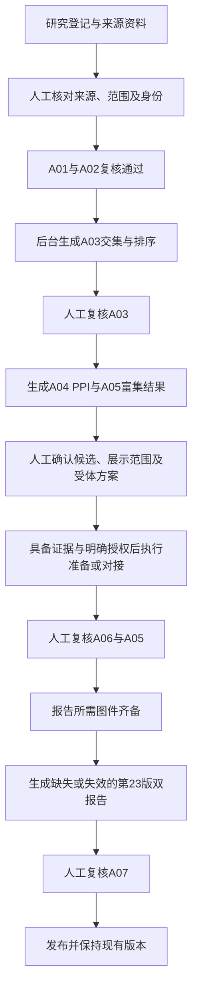

# Module A 初始版本验收记录

核查日期：2026-10-15。用户已认可总体框架，要求检查相关代码与自动化流程，作为初始版本验收。本记录区分用户的框架认可、软件技术验证和每项研究的科研复核。核查起点为development提交`53f7ef92ed5a1e3ad86d377cc0249a38fb8b2ad3`，验收基线包含本轮接续及回收站边界修复。

用户已明确选择“先验收已有研究的半自动闭环”。本次技术验收范围为已有研究的半自动工作台：资料明确、上游已复核、授权范围已登记时，后台生成下一批结果并停在人工关口。新版网页的新建研究入口、三库联网自动采集和全新正式病例完整链路尚未完成接入或验收，不能记为已经通过的功能。

用户随后明确表示“07复核完毕，你确认吧”。系统当时尚无当前A07的复核记录，本轮按该明确决定，经正式复核接口登记为“用户（本对话明确确认）”通过，意见保留原话及日期；来源是用户本次决定，技术检查不替代科研复核。报告修订保持第23版，未重新生成或计算。

## 已核查的自动化流程

这张图表示依赖与关口，A04/A05为独立分支；当前冻结编排依次调用这两项，不宣称同时运行。A06已确认扩展试算按已批准绑定交接既有225组评分，不再次运行Vina。新两梯队与覆盖准备停在方案、证据或明确计算授权关口，不退回旧版自动计算路线。

|对象|完成情况|验证方法|实际结果|证据位置|
|---|---|---|---|---|
|当前十个模块的页面与状态|已核查|实际本机接口GET、归档校验及用户复核后再次核对|A00/A01/A02/A03/A03_SELECT/A04/A05/A06已批准；A06_PREP为本批准备范围已核查；A07经本轮用户明确复核后已发布|read-only-proof.json；a07-user-confirmation-result.json；final-state-proof.json|
|后台任务生命周期|已核查|任务模块回归及隔离真实子进程|去重、启动失败、取消、进程丢失后标记中断及手动重试；不中断后自发恢复|shell-suite-proof.json；child-process-proof.json|
|报告自动接续|已修复并核查|先复现缺陷，再做接续回归及真实隔离任务|有效待复核/已发布A07不重复生成；缺A05复核或所需通路图时提示等待；缺失/失效报告可生成|continue-final.log；child-process-proof.json|
|回收站只读|已加强并核查|继续/重试接口及临时HTTP研究回归|回收站返回423 TRASHED_READONLY，不建立新任务；恢复后沿用原入口|task-readonly-final.log；api-final.log|
|人工关口与科学范围|已核查|新旧接续分支、源代码与回归|不代签A03候选、受体方案或A07；探索范围与严格质控分开，自动接续不解锁未经授权对接|continue-final.log；legacy-early-stop.log|
|按需出图与上传|已核查|原8项附件回归、既有11项浏览器证据及本轮只读页面|选择不启动任务，仅点击后整理所选；旧批量请求接口及后台均阻断；既有51包不自动补做|shell-suite-proof.json；上一轮ui-proof-final/proof.json；browser-proof.json|
|报告与历史保护|已核查|当前与历史文件SHA256、清单前后比较|当前两份Word与全部科研复核保持；315个历史报告文件及24个冻结科学源文件指纹一致|read-only-proof.json；manifest-before.json|
|运行环境与前端|已核查|doctor、同源静态资源与真实接口数据渲染|科学解释器及六项依赖可用，已有研究归档有效；前端保持人工复核及来源缺口提示|doctor.log；browser-proof.json|

本地证据统一保存于重构根目录的`audit_20261015/initial_acceptance_v1/`，研究资料、任务库、日志、截图和过程文件不进入GitHub。上一轮报告版式证据为`audit_20261015/report_layout_v23/`，专业版17页、简略版2页已逐页检查；报告文件未因本次验收而重建。

## 已修复的问题

1. 扩展A06分支原先在每次继续时直接重建A07，包括已有有效待复核报告和已发布报告；现保留有效A07，仅缺失或失效时生成。发布后继续返回流程完成。
2. 原分支在A05未批准或首位命中图未准备时进入报告生成并失败；现先提示明确人工停点。合法无显著KEGG不要求补图。
3. 继续与重试接口原先只检查研究存在，回收站研究仍可能建立一个最终被内核阻止的后台任务；现于接口层直接拒绝，不启动子进程。

## 留到下一阶段的范围

- 新版网页的新建研究登记入口及其MeSH身份核对、来源配置流程。
- A01三库自动采集和受限数据库资料的获取；本版以明确上传资料为入口，不承诺无人值守下载。
- 在新的方剂—疾病组合上，从登记、来源、身份、结构质控到双报告完成一次正式端到端验收。本次没有新建正式病例或重新开展科学计算。
- 冻结内核中的历史病例专用配置与路径拆解、Python/R完整依赖锁定。当前外壳新增代码不写死病例，历史内核边界仍保留。
- 其他研究的A07仍须各自独立人工复核，当前用户确认不外推。

框架认可不自动批准研究结论，不将扩展试算解释为全部受体严格质控通过。本次不自动合并main、不改变科学参数、不改正式Word项目大纲。后续若扩大验收到新版网页新建研究，应完成上述入口与新病例验证后再给出完整通过结论。

## 本轮验收结论

在用户明确选择的“已有研究的半自动闭环”范围内，初始版本技术验收通过。去重计算229项外壳测试及3项早期停点测试，共232项通过；修订后已重跑受影响的接续、回收站和实际HTTP接口用例。另有隔离真实后台子进程、10个当前模块接口、9个桌面/窄屏页面状态检查，均通过。

A07已按用户本轮明确复核通过并发布，第23版两份Word字节保持。发布后再次继续返回流程完成且不生成新报告。当前已有研究的10个关口中，9项正式通过/发布，1项为本批扩展准备范围已核查；后者不改记为全部严格结构质控通过。

下一阶段优先处理新版网页新建研究入口，再使用新的方剂—疾病及真实来源资料完成独立全流程验收；本次通过结论不涵盖该范围。
